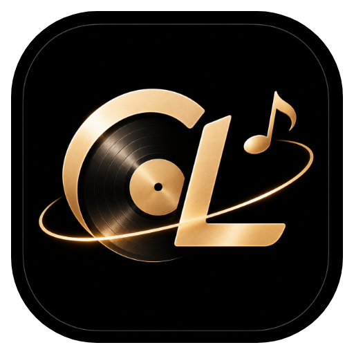
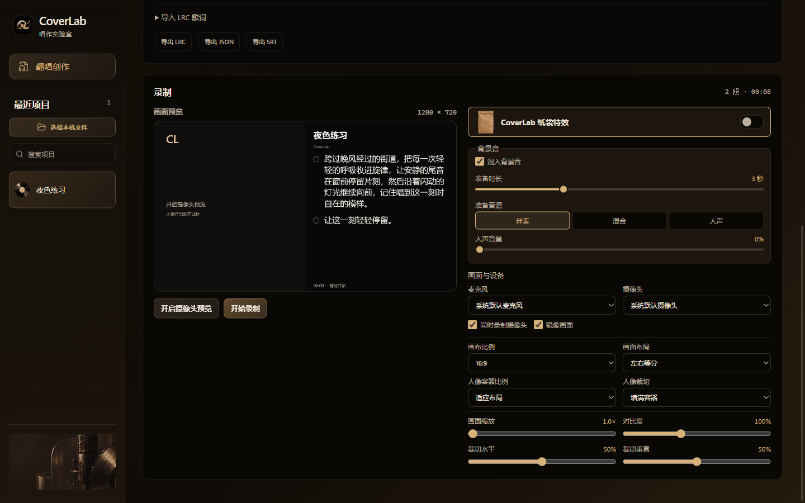

  
  <h1>CoverLab</h1>
  
分离伴奏 · 选句跟唱 · 录制翻唱

  
<a href="https://github.com/cyrus-cl/CoverLab/releases/latest"><strong>下载 Windows x64</strong></a>

---

CoverLab 是一款 Windows 翻唱录制工具。导入一首歌，分离伴奏和原唱，选择要唱的歌词，再用麦克风和摄像头录下一段。

## 开始录制

| | 操作 |
| --- | --- |
| **01　导入** | 从 Releases 下载 Windows x64 ZIP，解压并运行安装程序。打开 CoverLab，选择一首歌。 |
| **02　选句** | 点击「生成伴奏和歌词」，勾选要唱的句子并试听。可编辑歌词或导入 LRC。 |
| **03　录制** | 选择构图、纸袋特效、录前准备时间和原唱强度。录制后保存或下载 WebM。 |

## 录制设置

- **录前准备**可设为 0–10 秒，每段单独倒计时。可选纯伴奏、伴奏＋原唱或仅原唱。准备音保留在成片中。
- **原唱强度**可从 0% 调到 100%。0% 为纯伴奏，50% 为原唱半幅增益，麦克风独立录入。
- **画面**支持横版、竖版、方形、歌词与人像分屏、画中画和跟随头部的 CoverLab 纸袋。

首次分轨需要联网下载约 80 MiB 模型。云端歌词识别需要联网，用户确认后上传分离人声，无需自行配置 API Key。公共服务单首上限 8 分钟，按可用额度提供。分轨和录制在设备上进行。

[第三方软件声明](docs/licenses/THIRD_PARTY_NOTICES.md)
